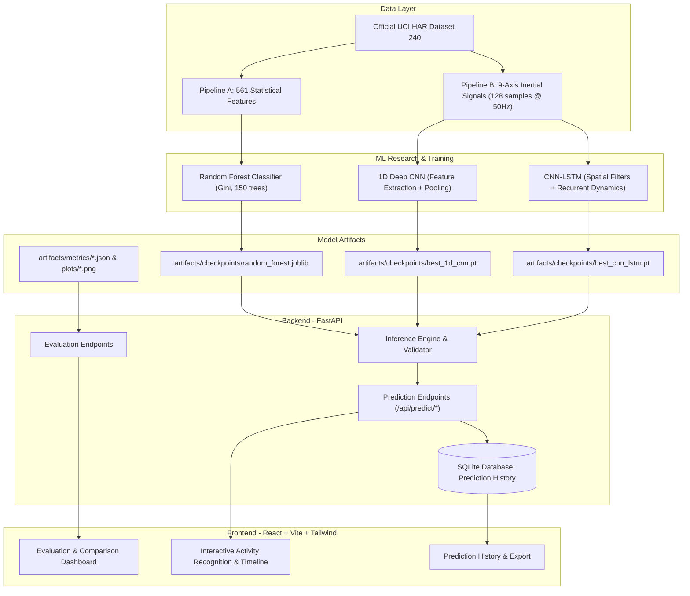

# MotionSense — System & Research Architecture

## 1. High-Level System Architecture

MotionSense is engineered as a decoupled, multi-tier platform separating data ingestion, machine learning research pipelines, production inference, and interactive visualization.

---

## 2. Input Pipeline Specifications

### Pipeline A — Feature-Based Pipeline (Random Forest)
- **Source**: 561 pre-computed time and frequency domain variables (`X_train.txt`, `X_test.txt`).
- **Feature Categories**: Mean, standard deviation, median absolute deviation, max/min, signal magnitude area, energy, interquartile range, autoregression coefficients, correlation coefficients, skewness, kurtosis, and spectral energy bands.
- **Dimensionality**: `(N, 561)` float32 vector.
- **Normalization**: Pre-normalized in $[-1, 1]$ in original UCI HAR dataset.

### Pipeline B — Raw Inertial Signals Pipeline (1D CNN & CNN-LSTM)
- **Source**: 9 raw tri-axial inertial sensor files per window located in `Inertial Signals/`.
- **Channels (Exact Order)**:
  1. `total_acc_x`: Total acceleration from accelerometer ($x$-axis, units: $g$).
  2. `total_acc_y`: Total acceleration from accelerometer ($y$-axis, units: $g$).
  3. `total_acc_z`: Total acceleration from accelerometer ($z$-axis, units: $g$).
  4. `body_acc_x`: Estimated body acceleration component ($x$-axis).
  5. `body_acc_y`: Estimated body acceleration component ($y$-axis).
  6. `body_acc_z`: Estimated body acceleration component ($z$-axis).
  7. `body_gyro_x`: Angular velocity from gyroscope ($x$-axis, units: $\text{rad/s}$).
  8. `body_gyro_y`: Angular velocity from gyroscope ($y$-axis, units: $\text{rad/s}$).
  9. `body_gyro_z`: Angular velocity from gyroscope ($z$-axis, units: $\text{rad/s}$).
- **Window Length**: 128 readings per channel ($\approx 2.56$ seconds at 50 Hz, 50% overlap of 64 readings).
- **Tensor Shape**: `(batch_size, 128, 9)` or `(batch_size, 9, 128)` transposed for PyTorch 1D convolutions.

---

## 3. Strict Subject Independence & Data Leakage Prevention

- **Subject Pool**: 30 volunteers aged 19–48.
- **Official Split**: 70% training (21 subjects), 30% testing (9 subjects).
- **Validation Partitioning**: Validation set is formed by grouping subjects exclusively from the training pool (e.g. 16 train subjects, 5 validation subjects). No subject ever appears in both train and validation splits, completely eliminating window overlap contamination.

---

## 4. Class Nomenclature & Integer Mapping

1. `WALKING`: Class 0 (0-indexed for PyTorch), Label 1 in UCI original.
2. `WALKING_UPSTAIRS`: Class 1 (Label 2).
3. `WALKING_DOWNSTAIRS`: Class 2 (Label 3).
4. `SITTING`: Class 3 (Label 4).
5. `STANDING`: Class 4 (Label 5).
6. `LAYING`: Class 5 (Label 6).
