# MotionSense — Human Activity Recognition Using Smartphones

[](https://archive.ics.uci.edu/dataset/240/human+activity+recognition+using+smartphones)
[-brightgreen.svg)](https://developer.android.com)
[](https://kotlinlang.org/)
[](https://developer.android.com/jetpack/compose)
[](https://onnxruntime.ai/)
[](https://www.python.org/)
[](https://pytorch.org/)
[](https://fastapi.tiangolo.com/)
[](https://react.dev/)
[](LICENSE)

MotionSense is a research-grade, production-ready Human Activity Recognition (HAR) platform featuring a **native Android mobile application** with real-time on-device machine learning inference, paired with a reproducible Python research training pipeline, FastAPI backend, and React analytics dashboard.

---

## 1. Project Overview

MotionSense recognizes physical human activities using the embedded tri-axial accelerometer and gyroscope sensors of standard smartphones. By processing continuous inertial measurements on the edge through optimized ONNX neural networks, MotionSense delivers private, ultra-low latency activity recognition without requiring cloud connectivity, external wearable sensors, or camera systems.

---

## 2. Problem Statement

Ubiquitous human activity monitoring is essential for digital healthcare, elderly fall risk assessment, fitness tracking, and contextual computing. Traditional solutions frequently suffer from:
- **Privacy Intrusion**: Video and camera-based tracking compromise user confidentiality in private environments.
- **Hardware Friction**: Dedicated fitness bands and wearable IMUs require separate charging, pairing, and maintenance.
- **Orientation Fragility**: Classic machine learning models trained on fixed-position datasets (e.g., waist holsters) fail catastrophically when a user holds the phone vertically in their hand or in different trouser pockets.
- **Latency & Connectivity**: Streaming high-frequency raw sensor data to cloud backends consumes excessive cellular bandwidth and fails in offline environments.

---

## 3. Project Objectives

1. **Native On-Device Execution**: Execute complete sensor conditioning, filtering, windowing, and inference locally on Android devices with $< 2\text{ ms}$ latency.
2. **Rotation-Invariant Recognition**: Implement a mathematically robust 2-class model (`WALKING` vs `STATIONARY`) using 3D Euclidean magnitude norms ($\|v\|$) that operates reliably in handheld vertical portrait orientation.
3. **Rigorous Research Correctness**: Benchmark on the official **UCI Human Activity Recognition (UCI HAR) Dataset 240** using strictly subject-stratified splits (zero subject data leakage).
4. **Exact Preprocessing Parity**: Implement an exact 3rd-order digital low-pass Butterworth filter ($0.3\text{ Hz}$ cutoff at $50\text{ Hz}$ sampling) using 64-bit Direct Form II Transposed to mirror clinical dataset preprocessing on Android.
5. **Physical Device Ground-Truth Recorder**: Provide an in-app sensor data recorder capable of logging raw 50 Hz CSV sessions with user-selected activity ground truth for real-world validation.

---

## 4. Supported Activity Classes

| Activity Class | Category | Characteristics | Supported Models |
| :--- | :---: | :--- | :--- |
| **`WALKING`** | Dynamic | Periodic rhythmic forward locomotion on level ground | Binary, 3-Class, 1D CNN, CNN-LSTM |
| **`NOT_WALKING` (Stationary)** | Static | Absence of rhythmic body acceleration (standing, sitting, resting) | Binary Invariant |
| **`WALKING_UPSTAIRS`** | Dynamic | Ascending stairs with elevated vertical acceleration impulses | 1D CNN, CNN-LSTM |
| **`WALKING_DOWNSTAIRS`** | Dynamic | Descending stairs with distinct deceleration impact spikes | 1D CNN, CNN-LSTM |
| **`SITTING`** | Static | Upright seated posture (distinguishable in belt holster) | 3-Class, 1D CNN, CNN-LSTM |
| **`STANDING`** | Static | Upright standing posture with micro postural sway | 3-Class, 1D CNN, CNN-LSTM |
| **`LAYING`** | Static | Horizontal body alignment | 1D CNN, CNN-LSTM |
| **`UNKNOWN` ("Detecting...")** | State | Transition phase or low-confidence classification ($p < 0.60$) | All Models (Temporal Filter) |

---

## 5. Key Features

- **100% Native Android Client**: Built in Kotlin with Jetpack Compose Material 3 and modern unidirectional data flow.
- **On-Device ONNX Runtime**: Uses Microsoft ONNX Runtime Mobile C++ bindings (`ai.onnxruntime:onnxruntime-android:1.17.0`) for CPU-efficient inference.
- **4 Selectable Models at Runtime**:
  - `walking_binary.onnx`: Rotation-Invariant Binary Classifier (**Recommended for Handheld**, 99.86% test accuracy).
  - `three_class.onnx`: 3-Class Classifier (Walking, Sitting, Standing; 87.43% test accuracy).
  - `cnn_1d.onnx`: 6-Class 1D CNN (**UCI HAR Standard**, 93.99% test accuracy).
  - `cnn_lstm.onnx`: 6-Class CNN-LSTM Recurrent Model (90.74% test accuracy).
- **Foreground Tracking Service**: Continuous 50 Hz sensor collection and inference with screen off via `WAKE_LOCK` and persistent Android notification.
- **Live Sensor Telemetry**: Real-time display of sampling rate (Hz), timestamp jitter (ms), missing sample count, and channel min/max bounds.
- **Sensor Data Recorder**: Live 50 Hz CSV session recording with ground-truth labelling and native Android share sheet export.
- **Temporal Majority Voting**: 3-window circular buffer ($3.84\text{ seconds}$) eliminates single-window prediction flicker.
- **Local Persistence**: Embedded SQLite / Room database recording verified activity intervals and daily activity summaries.

---

## 6. Application Screenshots

```
┌─────────────────────────────────────────┐   ┌─────────────────────────────────────────┐
│ MotionSense — Live Activity Tracking    │   │ Sensor Data Recorder & CSV Export       │
├─────────────────────────────────────────┤   ├─────────────────────────────────────────┤
│                                         │   │ 🔴 Sensor Data Recorder [RECORDING]     │
│                 ╭─────╮                 │   │                                         │
│                │  🚶  │                 │   │ Select Ground-Truth Label:              │
│                 ╰─────╯                 │   │ [WALKING]  [SITTING]  [STANDING]        │
│                                         │   │                                         │
│                 Walking                 │   │ Recording: WALKING • 842 samples • 16s  │
│          Dynamic Motion • Handheld      │   │                                         │
│                                         │   │ [ STOP & SAVE CSV RECORDING ]           │
│ Model Confidence: 99%                   │   │                                         │
│ ████████████████████████████████ 99%    │   │ Saved Recordings (3):                   │
│                                         │   │ • motionsense_walking_handheld.csv (42K)│
│ Session: 04:32     Sampling: 50.1 Hz    │   │ • motionsense_sitting_handheld.csv (38K)│
│                                         │   │ [ Share CSV via Android ShareSheet ]    │
│ [ STOP TRACKING ]                       │   │                                         │
│                                         │   │ 🔬 SENSOR & ML DIAGNOSTICS              │
│ Model: [Binary Invariant (Handheld)]    │   │ Sampling: 50.1 Hz  Jitter: 0.84 ms       │
│ Placement: [Handheld] [Pocket] [Waist]  │   │ Gravity: gx:+0.02g gy:+0.98g gz:+0.05g   │
└─────────────────────────────────────────┘   └─────────────────────────────────────────┘
```

---

## 7. System Architecture Diagram

```mermaid
flowchart TD
    subgraph Hardware ["Hardware Layer"]
        ACC["Tri-Axial Accelerometer\n(m/s² @ 50 Hz)"]
        GYR["Tri-Axial Gyroscope\n(rad/s @ 50 Hz)"]
    end

    subgraph Preprocessing ["Digital Signal Processing (Android)"]
        Norm["Unit Normalization\n(accel / 9.80665 m/s² -> g)"]
        BW["3rd-Order 0.3 Hz Butterworth Filter\n(Direct Form II Transposed in 64-bit)"]
        BodyAcc["Body Acc Extraction\n(total_acc - gravity)"]
        Coord["Coordinate Alignment\n(Handheld / Pocket / Waist)"]
        Buffer["Sliding Window Buffer\n(128 samples, 50% overlap = 64-sample stride)"]
    end

    subgraph ONNXEngine ["On-Device Neural Inference (ONNX Runtime Mobile)"]
        Tensor["Input Tensor: [1, 128, 9]\n(1152 Float32 elements)"]
        M_Bin["walking_binary.onnx\n(3D Euclidean Norms)"]
        M_1D["cnn_1d.onnx\n(Multi-stage 1D Conv)"]
        M_3C["three_class.onnx\n(Walk/Sit/Stand)"]
        M_LSTM["cnn_lstm.onnx\n(Conv + LSTM)"]
        Softmax["Softmax & Logits Output"]
    end

    subgraph Postprocessing ["Postprocessing & Presentation"]
        Gate["Confidence Gating\n(Flag UNKNOWN if p < 0.60)"]
        Vote["Temporal Smoothing\n(3-Window Rolling Majority Vote)"]
        UI["Jetpack Compose UI\n(Live Activity Display)"]
        DB["Room Database\n(Activity History & Daily Summary)"]
        CSV["SensorDataRecorder\n(50 Hz Ground-Truth CSV Export)"]
    end

    ACC --> Norm
    GYR --> Coord
    Norm --> BW
    Norm --> Coord
    BW --> BodyAcc
    BodyAcc --> Coord
    Coord --> Buffer
    Buffer --> Tensor
    Tensor --> M_Bin
    Tensor --> M_1D
    Tensor --> M_3C
    Tensor --> M_LSTM
    M_Bin --> Softmax
    M_1D --> Softmax
    M_3C --> Softmax
    M_LSTM --> Softmax
    Softmax --> Gate
    Gate --> Vote
    Vote --> UI
    Vote --> DB
    Coord -. 50 Hz Stream .-> CSV
```



---

## 8. Technology Stack

### Mobile Application
- **Language**: Kotlin 2.0+
- **UI Framework**: Android Jetpack Compose Material 3
- **Inference Runtime**: Microsoft ONNX Runtime Mobile (`ai.onnxruntime:onnxruntime-android:1.17.0`)
- **Architecture**: MVVM (Model-View-ViewModel) with Unidirectional Data Flow (`StateFlow`)
- **Local Persistence**: Room SQLite ORM
- **Target OS**: Android 8.0 Oreo (API 26) through Android 16 (API 36)
- **Build System**: Gradle 9.1 / Android Gradle Plugin 8.9.0

### Machine Learning & Data Science
- **Deep Learning Framework**: PyTorch 2.x
- **Model Formats**: PyTorch Checkpoints (`.pt`), Open Neural Network Exchange (`.onnx`)
- **Signal Processing**: SciPy (`scipy.signal.butter`), NumPy
- **Evaluation & Metrics**: Scikit-Learn

### Research Backend & Web Analytics (Optional)
- **API Framework**: FastAPI 0.110+ (Python 3.9+) with Pydantic v2 schemas
- **ASGI Server**: Uvicorn
- **Web Frontend**: React 18, TypeScript 5.0+, Vite, Tailwind CSS, Lucide Icons, Recharts

---

## 9. Machine Learning Architecture

### 9.1 Rotation-Invariant Binary Classifier (`walking_binary.onnx`)
- **Input Shape**: `[batch_size, 128, 9]`
- **Feature Extraction**: Directly computes the Euclidean magnitude vectors within the computational graph:
  $$\|a_{\text{total}}[t]\| = \sqrt{a_x^2[t] + a_y^2[t] + a_z^2[t]}$$
  $$\|a_{\text{body}}[t]\| = \sqrt{a_{\text{body},x}^2[t] + a_{\text{body},y}^2[t] + a_{\text{body},z}^2[t]}$$
  $$\|\omega[t]\| = \sqrt{\omega_x^2[t] + \omega_y^2[t] + \omega_z^2[t]}$$
- **Classification Head**: Dense feed-forward layers mapping statistical features (mean, standard deviation, peak-to-peak) to class probabilities.
- **Model Size**: **11.0 KB**
- **Parity vs PyTorch**: Maximum absolute difference $< 5 \times 10^{-7}$.

### 9.2 1D Convolutional Neural Network (`cnn_1d.onnx`)
- **Input Shape**: `[batch_size, 128, 9]`
- **Structure**:
  - Conv1D(9 $\rightarrow$ 64, kernel=5) + BatchNorm + ReLU
  - Conv1D(64 $\rightarrow$ 128, kernel=5) + BatchNorm + ReLU + MaxPool1D(2)
  - Conv1D(128 $\rightarrow$ 256, kernel=3) + BatchNorm + ReLU + GlobalAveragePool1D
  - Dense(256 $\rightarrow$ 6)
- **Parameters**: 111,238 weights
- **Model Size**: **434 KB**

### 9.3 CNN-LSTM Recurrent Model (`cnn_lstm.onnx`)
- **Structure**: 2 Conv1D feature extractors followed by a 2-layer bidirectional LSTM (hidden size 128) and linear classifier.
- **Parameters**: 263,814 weights
- **Model Size**: **1,034 KB**

---

## 10. UCI HAR Dataset Information & Attribution

This project is trained and validated on the benchmark **Human Activity Recognition Using Smartphones Dataset** from the University of California, Irvine (UCI) Machine Learning Repository:

- **Dataset ID**: UCI Machine Learning Repository ID 240
- **Authors**: Jorge-L. Reyes-Ortiz, Davide Anguita, Alessandro Ghio, Luca Oneto, and Xavier Parra (2012)
- **Citation**:
  > *Anguita, D., Ghio, A., Oneto, L., Parra, X., & Reyes-Ortiz, J. L. (2013). A public domain dataset for human activity recognition using smartphones. In 21th European Symposium on Artificial Neural Networks, Computational Intelligence and Machine Learning (ESANN).*
- **Dataset Scale**: 30 volunteers aged 19–48 performing 6 activities wearing a Samsung Galaxy S II on the waist.
- **Raw Inertial Signals**: Triaxial accelerometer and gyroscope data captured at 50 Hz.
- **Subject Stratification**: Zero subject leakage: Subjects 1–21 (70%, 7,352 windows) assigned to training; Subjects 22–30 (30%, 2,947 windows) assigned to testing.

---

## 11. Sensor Specifications & Sampling Details

- **Sensor Type**: Triaxial capacitive accelerometer and MEMS angular rate gyroscope.
- **Sampling Frequency**: **50 Hz** ($20\text{ ms}$ interval, 20,000 microseconds).
- **Window Length**: **128 timesteps** ($128 \times 0.02\text{ s} = 2.56\text{ seconds}$).
- **Window Stride**: **64 timesteps** ($64 \times 0.02\text{ s} = 1.28\text{ seconds}$, 50% overlap).
- **Dynamic Gravity Extraction**: Real-time 3rd-order digital Butterworth filter ($0.3\text{ Hz}$ cutoff).
- **Physical Handheld Realities**:
  - In a waist holster (UCI experiment), Earth's gravity vector is on the **X-axis** ($a_x \approx +1g$).
  - In handheld portrait mode, gravity is on the **Y-axis** ($a_y \approx +1g$).
  - Unaligned models confuse handheld vertical walking with `LAYING`. MotionSense resolves this via coordinate alignment and the rotation-invariant binary model.

---

## 12. Project Folder Structure

```
human-activity-recognition/
├── android/                             # Native Android Mobile Application
│   ├── app/
│   │   ├── build.gradle.kts             # App-level dependencies & ONNX Runtime
│   │   └── src/
│   │       ├── main/
│   │       │   ├── AndroidManifest.xml   # Permissions & FileProvider
│   │       │   ├── assets/models/       # Embedded ONNX models (walking_binary, etc.)
│   │       │   ├── kotlin/com/motionsense/har/
│   │       │   │   ├── MainActivity.kt
│   │       │   │   ├── ml/              # MotionClassifier.kt (ONNX Runtime runner)
│   │       │   │   ├── sensor/          # SensorCollector, ButterworthFilter, SensorDataRecorder
│   │       │   │   ├── service/         # MotionTrackingService (Foreground service)
│   │       │   │   ├── data/            # Room Database & ActivityRecord models
│   │       │   │   └── ui/              # Jetpack Compose Screens, ViewModel, Theme
│   │       │   └── res/xml/             # FileProvider paths for CSV sharing
│   │       └── test/                    # Android Unit Tests
│   ├── build.gradle.kts
│   └── settings.gradle.kts
├── backend/                             # Python FastAPI Backend (Optional)
│   └── app/
│       ├── main.py                      # FastAPI application
│       ├── api/routes/                  # Inference, models, analytics endpoints
│       └── core/                        # ONNX/PyTorch model managers
├── frontend/                            # React + TypeScript Web Dashboard (Optional)
│   ├── src/
│   └── package.json
├── ml/                                  # ML Training & Research Core
│   ├── data/raw/                        # UCI HAR dataset download location
│   └── models/checkpoints/              # Trained PyTorch .pt model weights
├── scripts/                             # Utility & Automation Scripts
│   ├── download_dataset.py              # Automated UCI HAR downloader
│   ├── verify_dataset.py                # Dataset shape & integrity verification
│   ├── train_simplified_models.py       # Trains & exports binary and 3-class ONNX
│   ├── export_models_for_mobile.py      # Exports 1D CNN and CNN-LSTM to ONNX
│   └── publish_github_release.py        # Automated GitHub Release publisher
├── docs/                                # Detailed Project Documentation
│   ├── PROJECT_ARCHITECTURE.md
│   ├── ANDROID_APP_DOCUMENTATION.md
│   └── DATASET_DOCUMENTATION.md
├── artifacts/
│   ├── apk/                             # Built release & debug APKs
│   └── metadata/                        # Verified evaluation JSON metrics
├── CONTRIBUTING.md
├── SECURITY.md
├── LICENSE
└── README.md
```

---

## 13. Prerequisites

To build and run MotionSense:

### For Android Mobile App
- Android smartphone running **Android 8.0 (API 26)** or higher with hardware accelerometer and gyroscope.
- To build from source:
  - **JDK 17** (e.g., Eclipse Adoptium Temurin 17)
  - **Android SDK** (API 34/36) with build-tools 34.0.0+
  - **Gradle 8.9+** (included via `./gradlew`)

### For Python ML & Backend
- Python 3.9, 3.10, or 3.11
- Virtual environment (`venv`) with dependencies in `requirements.txt`

---

## 14. Installation & Build Instructions

### 14.1 Building the Android APK from Source
```bash
# Clone the repository
git clone https://github.com/kalleRenuka303/MotionSense-Human-Activity-Recognition.git
cd MotionSense-Human-Activity-Recognition/android

# Set environment variables (adjust paths to your local setup)
export JAVA_HOME="/path/to/jdk-17"
export ANDROID_HOME="$HOME/Library/Android/sdk"

# Run unit tests
./gradlew test

# Assemble Debug and Release APKs
./gradlew assembleDebug assembleRelease
```
Output APKs will be located at:
- `android/app/build/outputs/apk/debug/app-debug.apk`
- `android/app/build/outputs/apk/release/app-release.apk`

---

## 15. How to Install the APK on a Physical Phone

1. **Direct Download**: Download [**`MotionSense-v1.0-release.apk`**](https://github.com/kalleRenuka303/MotionSense-Human-Activity-Recognition/releases/download/v1.0.0-android/MotionSense-v1.0-release.apk) directly onto your Android device.
2. **Install via File Manager**: Tap the downloaded file in your notifications or **Downloads** folder.
3. **Allow Installation**: When prompted, enable *"Install unknown apps"* for your browser or file manager.
4. **Via ADB (Developer Mode)**:
   ```bash
   adb install -r artifacts/apk/MotionSense-v1.0-release.apk
   ```

---

## 16. How to Use the Application

1. **Launch MotionSense** on your Android device.
2. **Grant Permissions**: Allow Activity Recognition and Notification permissions when prompted.
3. **Select Carrying Style**:
   - Tap **Handheld** if holding the phone in front of you.
   - Tap **Pocket** if placing the phone vertically in your front trouser pocket.
   - Tap **Waist Belt** if testing in original horizontal UCI orientation.
4. **Start Tracking**: Tap **START REAL-TIME TRACKING**.
   - Walk normally: UI displays **Walking** in green.
   - Stop and remain still: UI displays **Stationary** in blue.
5. **Record Sensor Data**:
   - Scroll to **Sensor Data Recorder**.
   - Select an activity ground truth (e.g., `WALKING`).
   - Tap **START RECORDING**. Walk for 30–60 seconds, then tap **STOP & SAVE CSV RECORDING**.
   - Tap **View All** to review or share the recorded CSV via Google Drive or email.

---

## 17. Model Evaluation Results (Official Test Set, $N = 2,947$)

All models were evaluated strictly on the 9 unseen test subjects (Subjects 2, 4, 9, 10, 12, 13, 18, 20, 24) with **zero subject data leakage**:

| Model Architecture | Target Classes | Test Accuracy | Macro F1 | Walking Recall | Model Size | Inference Latency |
| :--- | :---: | :---: | :---: | :---: | :---: | :---: |
| **Rotation-Invariant Binary** | 2 (`WALK` / `STATIONARY`) | **99.86%** | **99.86%** | **100.00%** | **11.0 KB** | $< 0.5\text{ ms}$ |
| **1D CNN Baseline** | 6 UCI Classes | **93.99%** | **93.99%** | **95.96%** | **434 KB** | $< 1.5\text{ ms}$ |
| **CNN-LSTM Recurrent** | 6 UCI Classes | **90.74%** | **90.77%** | **93.58%** | **1,034 KB** | $4.5\text{ ms}$ |
| **3-Class Classifier** | 3 (`WALK` / `SIT` / `STAND`) | **87.43%** | **78.47%** | **100.00%** | **11.6 KB** | $< 0.5\text{ ms}$ |

```
Model A (Binary) Confusion Matrix (Test Set):
                      Predicted WALKING    Predicted STATIONARY
True WALKING                 1387                   0
True NOT_WALKING                4                1556
```

---

## 18. Testing Instructions

### Run Android Unit Tests
```bash
cd android
./gradlew test
```
Tests verify:
- Butterworth filter DC steady-state response.
- Butterworth 0.3 Hz attenuation at 2 Hz walking frequency ($> 90\%$ attenuation).
- Coordinate alignment transformations for Handheld, Pocket, and Waist orientations.
- Channel ordering and activity enum mappings.

### Run Python Parity Verification
```bash
.venv/bin/python scripts/train_simplified_models.py
```
Verifies ONNX vs PyTorch output tensors with numerical parity $< 10^{-6}$.

---

## 19. Known Limitations

1. **Handheld Sitting vs Standing Ambiguity**: An inertial sensor held in the hand has no contact with the chair or floor. Holding a phone vertically while sitting produces identical stillness and gravity alignment ($a_y \approx +1g$) as standing. Sitting vs standing in hand cannot be separated without external contextual signals.
2. **Stair Height Variations**: Short staircases ($< 3$ steps) do not provide enough continuous 50 Hz cycles within a 2.56-second window to establish the cyclical energy profile of `WALKING_UPSTAIRS`.
3. **Loose Pockets**: Loose-fitting coats or bags introduce independent swinging motions that distort ground-reaction forces.

---

## 20. Future Enhancements

- **Barometric Altimeter Fusion**: Integrate smartphone barometric pressure sensors to distinguish stair ascent and descent from level walking.
- **On-Device Personalization**: Implement federated micro-fine-tuning on the device to adapt to user-specific walking cadence.
- **Wear OS / Smartwatch Companion**: Pair with Wear OS smartwatches to combine wrist and pocket IMU streams for sitting vs standing disambiguation.

---

## 21. Contributors

- **MotionSense Engineering Team**
- **Repository Owner**: [`kalleRenuka303`](https://github.com/kalleRenuka303)

---

## 22. License

This project is licensed under the **MIT License**. See the [LICENSE](LICENSE) file for complete details.
