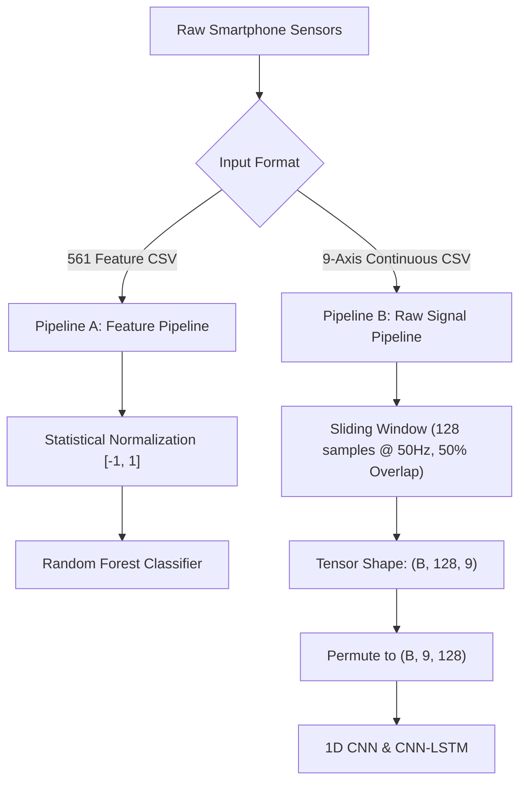

# MotionSense Data Preprocessing & Signal Pipeline

## 1. Architectural Overview
MotionSense strictly decouples two input pipelines to ensure zero information leakage and prevent improper data transformations.

---

## 2. Pipeline A: Feature-Based Ingestion (Random Forest)
- **Input Dimension**: Vector of 561 floating point values per activity window.
- **Source Files**: `X_train.txt`, `X_test.txt` from UCI HAR Dataset 240.
- **Normalization**: Values are bounded within $[-1, 1]$ according to the original UCI HAR normalization.
- **Zero Leakage Handling**:
  - No synthetic scaling fitted across combined splits.
  - Features preserved in strict order documented in `features.txt`.

---

## 3. Pipeline B: Raw Inertial Signals (1D CNN & CNN-LSTM)
- **Input Dimension**: `(batch_size, 128, 9)` where $128$ represents temporal time steps ($\approx 2.56$ seconds at 50 Hz) and $9$ denotes the exact sensor channel sequence.
- **Channel Sequence (Mandatory)**:
  1. `total_acc_x`
  2. `total_acc_y`
  3. `total_acc_z`
  4. `body_acc_x`
  5. `body_acc_y`
  6. `body_acc_z`
  7. `body_gyro_x`
  8. `body_gyro_y`
  9. `body_gyro_z`

### Sliding Window Extraction
When processing continuous time-series uploads:
$$\text{Window Length} = 128 \text{ samples} \quad (2.56 \text{ s})$$
$$\text{Step Size} = 64 \text{ samples} \quad (50\% \text{ overlap})$$
Labels are assigned via majority voting across the 128 readings within each window.

---

## 4. Subject-Aware Cross Validation
- **Train Pool**: Subjects 1, 3, 5, 6, 8, 11, 15, 16, 17, 21, 22, 25, 26, 27, 29, 30 (16 subjects, 5,607 windows).
- **Validation Pool**: Subjects 7, 14, 19, 23, 28 (5 subjects, 1,745 windows).
- **Test Pool**: Subjects 2, 4, 9, 10, 12, 13, 18, 20, 24 (9 subjects, 2,947 windows).
- **Overlap Verification**: Verified $\text{Train} \cap \text{Val} = \emptyset$ and $\text{Train} \cap \text{Test} = \emptyset$.
