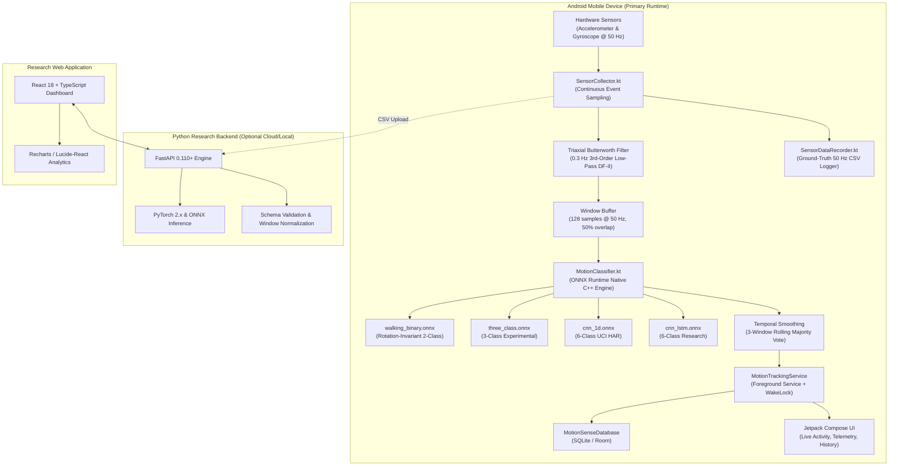

# MotionSense — System Architecture Documentation

This document describes the end-to-end system architecture, data pipelines, signal processing mechanics, and machine learning models comprising the **MotionSense** platform.

---

## 1. High-Level System Architecture

MotionSense is designed as an autonomous, edge-first Human Activity Recognition (HAR) platform. The primary production runtime executes on native Android devices using on-device neural network inference, supported by an optional Python research backend and React web dashboard.

---

## 2. Sensor Processing & Signal Conditioning Pipeline

### 2.1 Sensor Sampling Specification
- **Sensors**: Hardware tri-axial accelerometer (`Sensor.TYPE_ACCELEROMETER`) and hardware gyroscope (`Sensor.TYPE_GYROSCOPE`).
- **Target Rate**: **50 Hz** ($T_s = 20\text{ ms}$, 20,000 microseconds).
- **Channels**: 9 synchronized floating-point signals:
  1. `total_acc_x` ($g$ units)
  2. `total_acc_y` ($g$ units)
  3. `total_acc_z` ($g$ units)
  4. `body_acc_x` ($g$ units)
  5. `body_acc_y` ($g$ units)
  6. `body_acc_z` ($g$ units)
  7. `body_gyro_x` ($\text{rad/s}$)
  8. `body_gyro_y` ($\text{rad/s}$)
  9. `body_gyro_z` ($\text{rad/s}$)

### 2.2 Direct Form II Transposed 3rd-Order Butterworth Filter
To accurately mirror the UCI HAR preprocessing protocol without phase distortion, a 3rd-order digital low-pass Butterworth filter ($f_c = 0.3\text{ Hz}$, $f_s = 50\text{ Hz}$) is implemented using 64-bit Direct Form II Transposed:

$$H(z) = \frac{b_0 + b_1 z^{-1} + b_2 z^{-2} + b_3 z^{-3}}{1 + a_1 z^{-1} + a_2 z^{-2} + a_3 z^{-3}}$$

- **Filter Coefficients**:
  - $b_0 = 7.02055627 \times 10^{-5}$
  - $b_1 = 2.10616688 \times 10^{-4}$
  - $b_2 = 2.10616688 \times 10^{-4}$
  - $b_3 = 7.02055627 \times 10^{-5}$
  - $a_1 = -2.92544770$
  - $a_2 = 2.85387400$
  - $a_3 = -0.92837466$
- **Body Acceleration Separation**:
  $$\vec{a}_{\text{gravity}}[n] = \text{ButterworthFilter}(\vec{a}_{\text{total}}[n])$$
  $$\vec{a}_{\text{body}}[n] = \vec{a}_{\text{total}}[n] - \vec{a}_{\text{gravity}}[n]$$

---

## 3. Machine Learning Models & On-Device Execution

### 3.1 Model Catalog

| Model | File | Input Tensor | Target Classes | Benchmark Acc | Handheld Target |
| :--- | :--- | :---: | :---: | :---: | :--- |
| **Rotation-Invariant Binary** | `walking_binary.onnx` | `[1, 128, 9]` | 2 (`WALKING`, `NOT_WALKING`) | **99.86%** | **Recommended for Handheld** |
| **3-Class Classifier** | `three_class.onnx` | `[1, 128, 9]` | 3 (`WALK`, `SIT`, `STAND`) | **87.43%** | Experimental |
| **1D CNN Baseline** | `cnn_1d.onnx` | `[1, 128, 9]` | 6 UCI HAR Classes | **93.99%** | Waist Holster / Pocket |
| **CNN-LSTM Recurrent** | `cnn_lstm.onnx` | `[1, 128, 9]` | 6 UCI HAR Classes | **90.74%** | Research Model |

### 3.2 Rotation Invariance Architecture (Model A)
Handheld smartphone testing inherently involves arbitrary orientation angles (portrait, landscape, tilted in hand). To achieve true orientation independence without manual recalibration, `walking_binary.onnx` operates on 3D Euclidean vector magnitudes:

$$a_{\text{mag}}[t] = \sqrt{a_x^2[t] + a_y^2[t] + a_z^2[t]}$$
$$a_{\text{body,mag}}[t] = \sqrt{a_{\text{body},x}^2[t] + a_{\text{body},y}^2[t] + a_{\text{body},z}^2[t]}$$
$$\omega_{\text{mag}}[t] = \sqrt{\omega_x^2[t] + \omega_y^2[t] + \omega_z^2[t]}$$

Because the Euclidean norm is mathematically invariant under orthogonal transformation matrices ($\|R \cdot \vec{v}\| = \|\vec{v}\|$ for any $R \in \text{SO}(3)$), the model produces identical predictions regardless of how the user holds the phone.

---

## 4. Android Implementation Architecture

- **Language & Runtime**: 100% Kotlin, Jetpack Compose Material 3, Android SDK 26–36.
- **Inference Engine**: Microsoft ONNX Runtime Mobile (`ai.onnxruntime:onnxruntime-android:1.17.0`).
- **Threading**:
  - Sensor event processing: High-priority background sensor thread.
  - Model classification: `Dispatchers.Default` coroutine scope.
  - UI updates: Jetpack Compose reactive state collection via `StateFlow`.
- **Background Execution**:
  - `MotionTrackingService`: Foreground service with `FOREGROUND_SERVICE_HEALTH` and `FOREGROUND_SERVICE_DATA_SYNC` permissions.
  - `PARTIAL_WAKE_LOCK`: Ensures continuous sensor polling during screen-off states.
- **Local Persistence**: Room SQLite database logging every verified activity episode with timestamp, confidence, duration, and model metadata.
